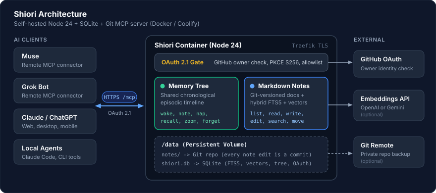
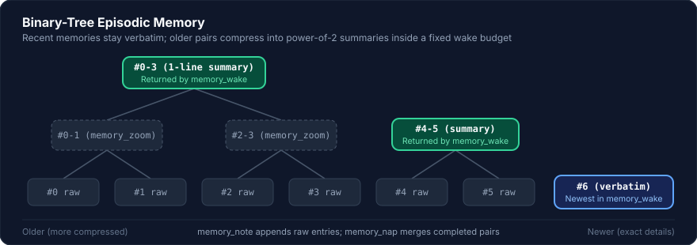
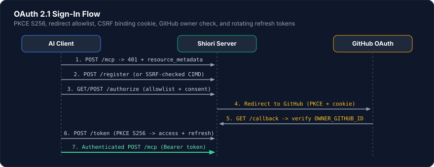
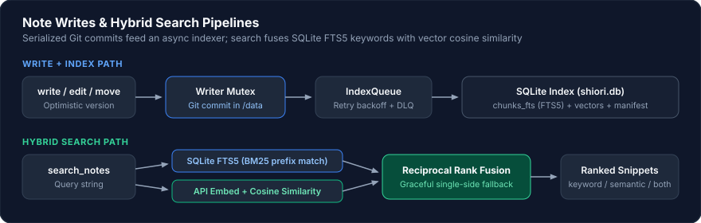

# Shiori Architecture



| Concern | How | Module |
|---|---|---|
| Runtime | Single **Node 24** HTTP server (Docker / Coolify) behind Traefik TLS | [src/index.ts](src/index.ts), [src/app.ts](src/app.ts) |
| Episodic Memory | Append-only `memory_log` + power-of-2 binary summary tree (`memory_tree`) in SQLite, plus `/data/memory.log` | [src/memory/tree.ts](src/memory/tree.ts) |
| Notes Storage | Local **Git** repository in `/data/notes` (optional backup push to a private remote) | [src/storage/git.ts](src/storage/git.ts) |
| Concurrency | In-process `Writer` mutex with optimistic `expected_version` checks | [src/writer/writer.ts](src/writer/writer.ts) |
| Indexing | Sequential in-process `IndexQueue` with exponential retry backoff and DLQ alerts | [src/queue.ts](src/queue.ts), [src/indexer/indexer.ts](src/indexer/indexer.ts) |
| Repair | Daily reconciliation job compares Git HEAD against SQLite manifest/FTS5/vectors | [src/reconcile/reconcile.ts](src/reconcile/reconcile.ts) |
| Search | **SQLite FTS5** (BM25 keyword) + **API embeddings** (OpenAI or Gemini) cosine similarity, fused via Reciprocal Rank Fusion | [src/search/hybrid.ts](src/search/hybrid.ts), [src/storage/sqlite-adapters.ts](src/storage/sqlite-adapters.ts) |
| Access | **OAuth 2.1** authorization server in SQLite, consent page, PKCE S256, SSRF-checked CIMD, redirect allowlist, GitHub owner check | [src/auth/oauth.ts](src/auth/oauth.ts) |

## Binary-Tree Episodic Memory



## OAuth 2.1 Sign-In Flow



## Note Writes & Hybrid Search Pipelines



## Repository Layout

```text
src/
  index.ts            Node HTTP server, streaming responses, daily maintenance, graceful shutdown
  app.ts              MCP tool registration, OAuth/admin/health routing
  config.ts           Environment variable loader and defaults
  queue.ts            In-process sequential indexing queue with retry backoff
  auth/oauth.ts       OAuth 2.1 authorization server + GitHub owner login
  memory/             Binary-tree episodic memory engine and agent prompt
  writer/             Serialized Git writer and optimistic version hashing
  indexer/            Chunking, FTS5 + vector indexing logic
  reconcile/          Daily diff/repair and full rebuild orchestration
  search/hybrid.ts    FTS5 query builder and Reciprocal Rank Fusion
  storage/            node:sqlite DB, FTS5/vector adapters, Git CLI working copy, embedders
docs/
  diagrams/           SVG architecture and flow diagrams
test/                 Vitest unit and end-to-end tests
```
