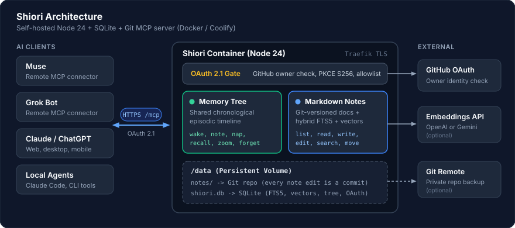
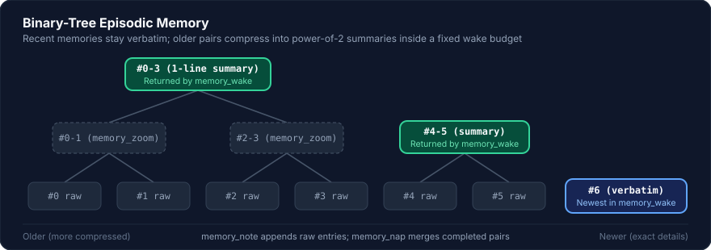

# Shiori (栞)

<p align="center">
  <a href="https://github.com/8bury/shiori/actions/workflows/ci.yml"></a>
  
  
  
  <a href="LICENSE"></a>
</p>

**Shared memory and Markdown notes for all your AI agents.**

*Shiori* (栞, *bookmark / trail marker*) is a self-hosted remote MCP server that lets **Muse**, **Grok**, **Claude**, **ChatGPT**, and your local coding agents share the same context. Start a conversation in one agent and pick it up in another without repeating yourself.

## How it works



Shiori runs as a single lightweight **Node 24 + SQLite + Git** container with two complementary layers:

1. **Episodic Memory Tree:** An append-only timeline of 1-line facts, preferences, and decisions, organized into a binary tree of summaries. When any agent starts a session (`memory_wake`), it gets recent memories verbatim and older memories exponentially compressed inside a fixed token budget, and can drill down (`memory_zoom`) or search (`memory_recall`) anytime.
2. **Long-form Notes:** Editable Markdown documents backed by a real Git repository (every edit is a commit, nothing is ever lost) with hybrid search combining SQLite FTS5 keywords and API embeddings (OpenAI, Gemini, or keyword-only).
3. **Zero-trust OAuth 2.1:** Every client authenticates via OAuth 2.1 + GitHub sign-in restricted to your numeric `OWNER_GITHUB_ID`, with a consent screen, PKCE S256, redirect allowlist, and per-client grant revocation.



See [ARCHITECTURE.md](ARCHITECTURE.md) for the OAuth 2.1 and hybrid search flow diagrams.

## Quick start (Coolify / Docker)

1. **Create a GitHub OAuth App** (*Settings → Developer settings → OAuth Apps*):
   - **Homepage URL:** `https://shiori.yourdomain.com`
   - **Authorization callback URL:** `https://shiori.yourdomain.com/callback`
2. **Deploy in Coolify** (or any Docker host):
   - Point a new resource at `8bury/shiori` using the `Dockerfile`.
   - Mount a persistent volume at `/data` (stores `/data/notes`, `/data/shiori.db`, and `/data/memory.log`).
   - Set your domain (`https://shiori.yourdomain.com`). Coolify/Traefik handles HTTPS and checks `/health`.
3. **Configure environment variables** (see [.env.example](.env.example)):
   - `PUBLIC_URL`, `GITHUB_CLIENT_ID`, `GITHUB_CLIENT_SECRET`, `OWNER_GITHUB_ID`
   - `ADMIN_SECRET` (random hex string for `/admin/*`)
   - `EMBEDDING_PROVIDER` (`openai`, `gemini`, or `none`) and `EMBEDDING_API_KEY`
   - `ALLOWED_REDIRECT_PREFIXES` (comma-separated callback prefixes for extra clients like Muse or Grok; Claude, ChatGPT, and localhost are allowed by default)

Full setup, importing existing notes, and operations: [docs/setup.md](docs/setup.md).

## Local development

```sh
npm ci
cp .env.example .env
npm run dev
```

Run checks:

```sh
npm run lint
npm run typecheck
npm run build
npm test
```

## Connecting your agents

- **Claude Code:**
  ```sh
  claude mcp add -s user --transport http shiori https://shiori.yourdomain.com/mcp
  ```
- **Muse, Grok, Claude (web/desktop/mobile), ChatGPT:** add a custom remote MCP connector pointing to `https://shiori.yourdomain.com/mcp`.
  - If a new client gets a `403` during sign-in, check the container logs for `{"auth":"redirect refused","redirectUri":"..."}` and add its callback prefix to `ALLOWED_REDIRECT_PREFIXES`.
- **Agent instructions:** Shiori sends usage instructions automatically via MCP server `instructions`. For best results, also paste [MEMORY_PROMPT.md](MEMORY_PROMPT.md) into your `AGENTS.md` / `CLAUDE.md` or custom instructions in Muse and Grok.

## MCP Tools

### Episodic Memory Tree
| Tool | Description |
|---|---|
| `memory_wake` | Read the logarithmic timeline (recent verbatim, older summarized) at session start |
| `memory_note` | Record a 1-line memory (<= 280 bytes); prompts for compression when a pair completes |
| `memory_nap` | Save a 1-line summary for a pending `#lo-hi` range (or check what is due) |
| `memory_recall` | Search every raw memory ever recorded (substring by default, or opt-in safe regex) |
| `memory_zoom` | Open a `#lo-hi` summary node into its two halves down to raw memories |
| `memory_forget` | Drop a bad `#lo-hi` summary (and ancestors) so the next `memory_nap` rebuilds it |

### Long-form Notes
| Tool | Description |
|---|---|
| `list_notes` | List Markdown note paths (optional prefix filter) |
| `read_note` | Read a note and its version hash |
| `search_notes` | Hybrid keyword (FTS5) + semantic (vector) search fused with Reciprocal Rank Fusion |
| `write_note` | Create or overwrite a note (with optimistic version check) |
| `edit_note` | Replace an exact passage in a note |
| `delete_note` | Delete a note (recoverable in Git history) |
| `move_note` | Move or rename a note in one commit |

## Admin endpoints

Protected by `Authorization: Bearer <ADMIN_SECRET>`:

- `GET /admin/grants`: list active OAuth client grants
- `DELETE /admin/grants/<id>`: revoke one client grant
- `POST /admin/reconcile`: reconcile the search index with Git (`?mode=rebuild` for a full rebuild)

## Credits & License

- Originally forked from [YudiG12/second-brain-mcp](https://github.com/YudiG12/second-brain-mcp) (MIT) and re-architected for self-hosted Node 24 + SQLite + Docker.
- Episodic memory tree inspired by [VictorTaelin/OptMem](https://github.com/VictorTaelin/OptMem).
- Licensed under the [MIT License](LICENSE).
